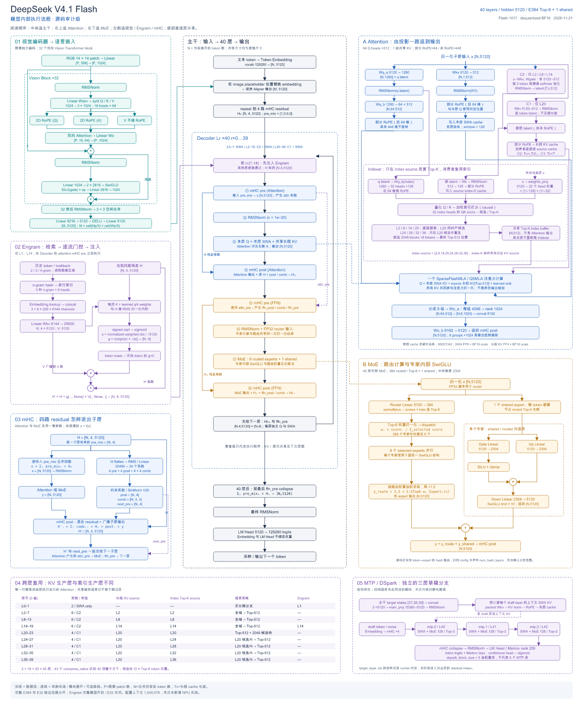

# DeepSeek V4.1 Flash 详细结构与执行流程

2026-11-21 修订。根据本仓 Flash-1017 完整反量化 BF16 配置、权重索引、归档实现与固定版本公开源码，重画为逐步计算图。

[总图 PNG](model-architecture.png) · [可编辑总图 SVG](model-architecture.svg) · [参数依据](facts.json) · [审计说明](audit.md)



## 按问题选图

| 要追踪的流程 | 高清 PNG | 可编辑 SVG |
|---|---|---|
| 输入、图文合并、40 层、逐层两组 mHC、输出 | [主干](decoder-detail.png) | [SVG](decoder-detail.svg) |
| Q/KV 投影、RoPE、C1/C2、Indexer、共享 cache、统一 attention、O 投影 | [Attention](attention-detail.png) | [SVG](attention-detail.svg) |
| Router、Top-6 选择及权重、shared 分支、专家内部 SwiGLU、加权汇合 | [MoE](moe-detail.png) | [SVG](moe-detail.svg) |
| ViT 的 Q/K/V、2D RoPE、双向 attention、两次残差、空间合并与 Aligner | [视觉](vision-detail.png) | [SVG](vision-detail.svg) |
| n-gram lookup、6144→25600 投影、逐流 gate、token mask、注入 | [Engram](engram-detail.png) | [SVG](engram-detail.svg) |
| 四路残差怎样 collapse、产生系数、混合，以及延迟交接 next_pre | [mHC](mhc-detail.png) | [SVG](mhc-detail.svg) |
| 40 层分别读取哪一层的 KV、哪一层的 Top-K，以及候选范围 | [逐层共享](layer-sharing-detail.png) | [SVG](layer-sharing-detail.svg) |
| target states、上下文 draft KV、三层草稿与 Markov/confidence | [MTP](mtp-detail.png) | [SVG](mtp-detail.svg) |

## 阅读方法

所有图从上向下读取；实线传数据，虚线表示系数、模块展开或可选路径。圆圈的 + 是相加，× 是逐元素乘法。每个线性投影都标明输入和输出维度。总图 3920×4740，细节图分别导出，阅读内部流程时优先打开对应细节图或 SVG。

层号从 0 开始。N 为当前展开 token 数，P 为图像 patch 数，M 为合并后的视觉 token 数，Tc 为长程 cache 长度。维度均为逻辑尺寸，不代表 TP/EP/PP 分片。

主干每层都计算自己的 Q 和 SWA KV。L2/L8/L14/L20 生产长程 KV；Indexer 另在 L24/L28/L32/L36 重算位置选择。消费者直接读 source cache 和 Top-K buffer，不把共享画成层被跳过。SWA 和长程 KV 共同进入一个注意力运算，不将两份独立 attention 输出相加。

Engram 在 L1/L14 的 Decoder 之前更新四路 residual。图中 gate 公式采用无旋转分支，数值稳定项被简写；带 Quarot 的可选分支须先还原 residual basis 再计算 gate，见源码。mHC 图按逻辑计算展示；原生 NPU kernel 内部融合和并行通信未逐 kernel 展开。

MoE 画出普通 score router。源码也支持 token→expert hash 路由与图像专用 bias；归档 config 未声明 num_hash_layers，不能确定额外层划分。路由选择与最终归一化权重分开；shared expert 不计入 Top-6。

MTP 的三个权重层是 mtp.0..2，运行编号 40..42，独立于 40 层主干。target_layer_ids 的取样点按 runner 约定，取进入对应层的 residual mean。block_size=5 不等于 5 层，结构存在也不代表投机解码已验收。

## 来源

配置与索引见上一级目录；每个来源的 SHA256、源码符号和固定提交 URL 见 facts.json。主干、图文 wrapper 使用原有 E32 运行归档；完整尺寸采用完整资产配置。视觉、cache、DSpark、Attention backend、Compressor、Indexer、Engram 内部使用 vLLM-Ascend 固定提交 28e9e97ba254b076a88275e8a275556cb9a11664，原文在 source/，保留 Apache-2.0 SPDX 声明。读取源码不执行模型、不加载完整权重。

布局参考用户提供的 Kimi K3 图；HY4 成品原图下载超时，未将未完整取得的图片用作视觉核对依据。结构、参数和连接均重新从本模型核对。

## 重绘

SVG 使用 Python 3.9+ 标准库生成，并可先验证原始资料的全部哈希：

```bash
python3 model/architecture/render_architecture.py --repo . --out model/architecture
```

PNG 使用现有 Node 环境中的 @resvg/resvg-js 2.6.2 与系统中文字体导出：

```bash
node model/architecture/render_png.cjs model/architecture
```

若渲染器安装在其他目录，设置 DSV41_RESVG_MODULE 为模块绝对路径。脚本不会安装包或字体。可编辑 SVG 中的节点 title/data-source 保存源码符号提示。上一版概览图、脚本与说明保存在 previous-overview/。

## 验证范围

本次完成配置与源码身份核对、主干/视觉/MTP 层数及专家数核对、SVG XML/PNG 完整性检查和渲染后人工视觉检查。完整 E384 与 E32、声明窗口与实测窗口、MTP 结构与运行状态保持区分；本次未新增 NPU、精度或性能实测结论。
