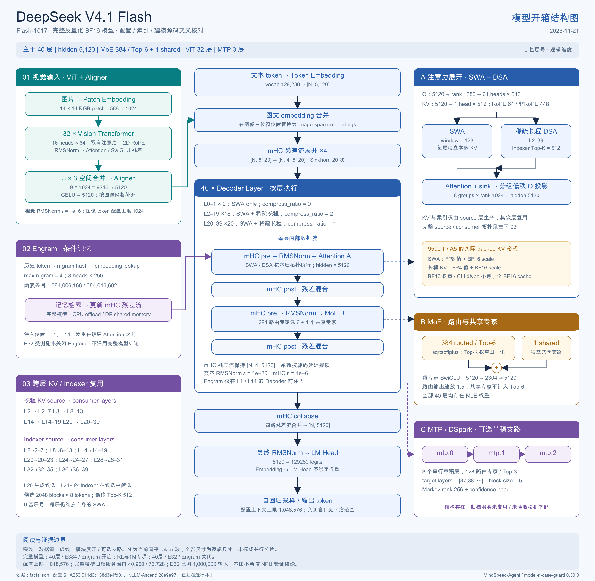

# DeepSeek V4.1 Flash 开箱结构图

更新日期：2026-11-21。本次按 MindSpeed-Agent `model-rl-case-guard 0.30.0` 的结构图交付规范，
对本仓库 DeepSeek-V4.1-Flash-1017 完整反量化 BF16 资产做静态结构审计。图示采用中央主干、
两侧模块展开的布局；结构和参数均来自本模型的配置、索引与建模源码。



[PNG 原图](model-architecture.png) · [可编辑 SVG](model-architecture.svg) ·
[参数与来源 facts.json](facts.json) · [结构审计](audit.md) · [绘图脚本](render_architecture.py)

## 如何阅读

- 从中央上方的文本输入向下阅读：embedding、图文合并、mHC 四路残差流、40 层 Decoder、
  mHC collapse、最终 RMSNorm 和 LM Head。N 是当前扁平 token 数；图中均为逻辑尺寸。
- 左上视觉分支采用 32 层 ViT、RMSNorm、双向注意力与 2D RoPE。3×3 空间合并后，
  Aligner 通过 `9216 → 5120 → 5120` 的 GELU MLP 接入图像占位符位置。
- Decoder 的两次 mHC pre/post 分别包围 Attention 和 MoE。Engram 在 L1、L14 的 Decoder
  之前注入；不是每层都运行 Engram，也不是位于模型输出之后。
- 主干注意力分布为 L0–1 的 SWA、L2–19 的 SWA+长程稀疏注意力、L20–39 的 SWA+长程
  稀疏注意力；图中 r 值直接采用 `compress_ratios`，不将 source/consumer 共享画成每层独立生成。
- 左下列出四个长程 KV source 和八个 Indexer source 的消费者范围；L24 及以后 Indexer
  source 使用 L20 生成的候选块。L20–23 的索引还不使用这一候选筛选。
- MoE 的 routed Top-6 不包括独立的 shared expert。图中 384 是完整模型专家数，图上的
  MTP 草稿专家数另记为 128 / Top-3。
- MTP/DSpark 是旁侧的三个串行草稿层，权重前缀为 `mtp.0..2`；不是把文本主干画成 43 层。
  `dspark_block_size=5` 不是 MTP 层数，也不等同于本次服务已启用的投机 token 数。

## 参数与实现依据

| 信息 | 依据 |
|---|---|
| 主干、视觉、MoE、Engram、MTP 参数 | [原始配置](../config.json)，每项配置键及 SHA256 见 `facts.json` |
| 40 层主干、32 层视觉、3 层 MTP、每层 384 routed experts 的存在性 | [权重索引](../model.safetensors.index.json)逐项核对；未加载权重数值 |
| mHC 顺序、Engram 注入、跨层复用、图文合并 | 既有[运行源码快照](../../reduced/cann930_20261120/routing_replay/source/final/)；解压后哈希与其 `source_versions.json` 一致 |
| 视觉、DSpark、cache 的细节 | vLLM-Ascend 固定提交 `28e9e97ba254b076a88275e8a275556cb9a11664`；原文副本在 [source](source/)，URL 与哈希见 `facts.json` |
| 已测运行范围 | [正式开箱报告](../../DSV41模型开箱交付件.md)、[完整模型配置审计](../../full/cann930_20261119_precision/run/config_audit.json)、[E32 长上下文报告](../../reduced/cann930_20261120/long_context/REPORT.md) |

源代码副本保留其 Apache-2.0 SPDX 声明。运行快照和公开基线两种身份分别记录；本次没有重新登录服务器核验运行态。

## 导出与复现

SVG 生成和来源核对仅需 Python 3.9+ 的标准库，不导入 torch、Transformers 或模型代码：

```bash
python3 model/architecture/render_architecture.py --svg-only
```

导出 PNG 时，在用于绘图的独立 Python 环境安装 [渲染依赖](requirements-render.txt)，再执行：

```bash
python3 -m pip install -r model/architecture/requirements-render.txt
python3 model/architecture/render_architecture.py
```

默认 PNG 为 2600×2540。需要更高分辨率可增加 `--png-width 5200`。
中文字体使用系统已有的 Arial Unicode MS、Noto Sans CJK SC 或 Hiragino Sans GB；
也可用 `--font-file /path/to/cjk-font.ttf` 指定字体文件。渲染器不会下载字体或安装系统组件。
源图可在 SVG 编辑器中编辑；修改模型参数时须同时更新 `facts.json`、来源哈希和对应图形标签。

## 验证范围

本次完成静态参数核对、源码身份校验和实际 PNG/SVG 渲染。图上的模块存在不代表其所有运行分支
已通过 NPU 验证。完整 E384、保留 40 层的 E32 副本、配置窗口、实测窗口和 MTP 未测状态分别标注。
图示不改变既有开箱结果，不新增推理、精度、性能或投机解码通过结论。
