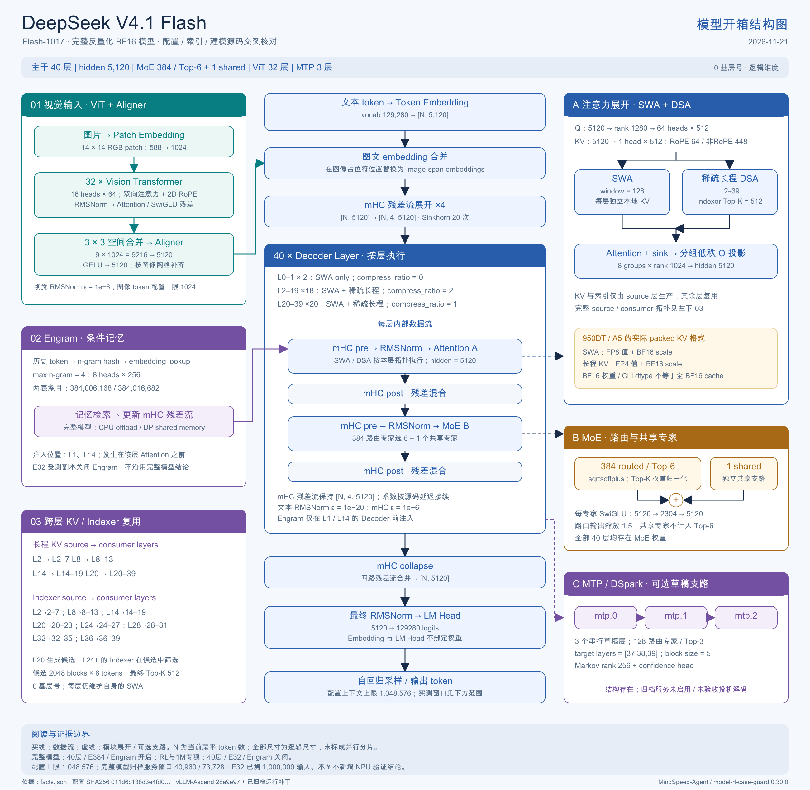

# DSV41 Flash BF16 模型结构与资产

依据归档 [config.json](config.json)、[权重索引](model.safetensors.index.json)、[转换清单](conversion-manifest.jsonl)和[源码摘录](source_excerpts.txt)。这是配置与实现层面的结构说明，不冒充逐算子完整shape审计或官方模型报告。

[可编辑SVG](architecture/model-architecture.svg) · [参数依据](architecture/facts.json) · [读图、来源与复现](architecture/README.md) · [结构审计](architecture/audit.md)

中央展开40层主干的逐层mHC/归一化/Attention/MoE数据流，左右展开视觉、Engram、注意力和MTP。层号从0开始，尺寸为逻辑维度；Engram只作用于L1、L14。3个MTP草稿层不计入40层主干，图中的可选模块不产生新的实机通过结论。

| 项目 | 配置事实 |
|---|---|
| 架构 / model_type | DeepseekV41ForCausalLM / deepseek_v41 |
| 文本层 / hidden / vocab | 40 / 5120 / 129280 |
| 注意力头 / KV头 / head_dim | 64 / 1 / 512；RoPE维度64 |
| Q / O LoRA rank | 1280 / 1024 |
| MoE | 384 routed experts，Top-6，1 shared expert，intermediate=2304 |
| SWA / Indexer | window=128；32 heads，head_dim128，Top-K512 |
| Hyper-connection | hc_mult=4，Sinkhorn迭代20 |
| Engram层（配置0基索引） | [1,14]；表条目[384006168,384016682]；8 heads × 256；max ngram=4 |
| 视觉 | 32层、hidden1024、16 heads、patch14、downsample3、max_image_tokens1024 |
| 配置上下文上限 | 1048576；CANN930完整模型性能/精度服务为40960/73728；缩减模型已完成[1M实测](../reduced/cann930_20261120/long_context/REPORT.md) |
| 下一token预测配置 | num_nextn_predict_layers=3；当前实测服务没有显式开启投机解码，不声明MTP已验证 |

## BF16资产来源

本次是从原量化checkpoint反量化得到的完整BF16资产，不将其写成“原生BF16官方发布权重”。来源历史路径为 `/mnt/weight/DeepSeek-V4.1-Flash-1017`，输出为 `/mnt/share/c00954197/workspace/dsv41-flash-bf16`。转换处理FP8+scale和打包FP4专家权重；未裁剪40层或384专家，Engram保留。

归档：[转换器](conversion/convert_deepseek_v41_flash_bf16.py)、[历史执行脚本](conversion/run_deepseek_v41_flash_bf16.sh)、[原始日志](conversion/dsv41-flash-bf16-convert.log)。日志末尾 `COMPLETE tensors=48496 raw_bytes=1526495246152`，输出525个分片。该日志证明导出完成，不等同全张量数值误差验收；[独立FP4/FP8抽样核验](dequant_validation_20261120/REPORT.md)已完成：34个代表性张量、4624个标量逐位一致；不等同全张量逐元素扫描。

转换脚本与完成日志作为资产来源记录；当前推理验收环境统一为CANN930。转换脚本具有写权重行为，本次文档整理没有执行该脚本。

## 权重精度与KV格式

`--dtype bfloat16 --hf-overrides '{"quantization_config":null}'`声明模型权重/计算配置。A5 DSV41实现会选择packed cache：SWA采用FP8值与BF16 scale，压缩MLA使用FP4值与BF16 scale，底层可用uint8存储。因此CLI `--kv-cache-dtype bfloat16`不能解读成所有实际KV存储均BF16，也不能据此认为混合量化attention报错等价于BF16权重不支持。

实现基线：vLLM-Ascend `28e9e97ba254b076a88275e8a275556cb9a11664`，`vllm_ascend/models/deepseek_v41/{model,cache_config,vl_model,vision}.py`。该[基础提交](https://github.com/vllm-project/vllm-ascend/commit/28e9e97ba254b076a88275e8a275556cb9a11664)已于2026-11-20核验公开可达，实际运行另叠加已交付补丁。
